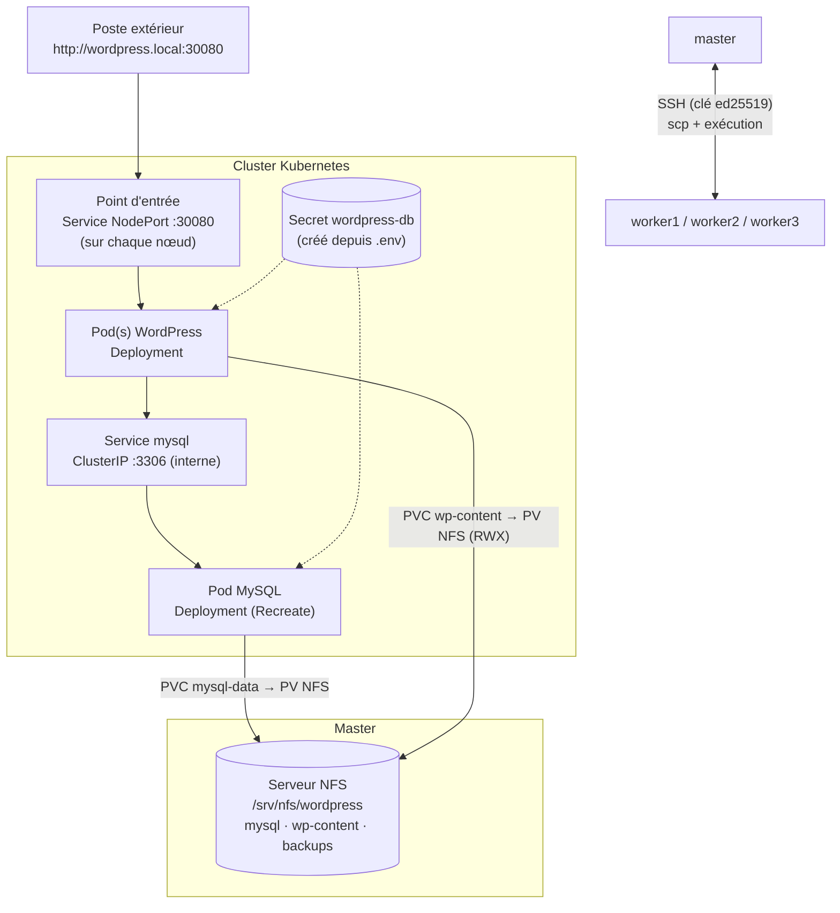

# WordPress sur Kubernetes, avec une démarche DevOps

**Mini-projet pratique.** Serveurs de réseaux locaux 3 (420H64RO), Hiver 2026
**Étudiant :** Radoslav Stoilov · **Groupe :** 00002 · **Enseignant :** Djibo Karimou

Le projet déploie de façon fiable et rejouable un site WordPress et sa base MySQL sur un cluster Kubernetes (1 master et 2 ou 3 workers), avec :
- des **données persistantes** sur NFS : la base et les fichiers survivent à la recréation des pods ;
- un **accès externe** par NodePort ;
- des **identifiants hors du dépôt** : Secret Kubernetes généré depuis `.env` ;
- un **master qui copie et exécute des scripts** sur les workers par SSH.

---

## 1. Architecture



| Composant | Choix | Justification |
|---|---|---|
| Stockage | PV NFS statiques (serveur sur le master), `Retain` | Le volume ne dépend pas d'un nœud : un pod recréé sur un autre worker retrouve ses données. `Retain` évite toute perte de données si une PVC est supprimée. `hostPath` ou `local` lieraient les données à un seul worker. |
| Base | `Deployment` à 1 réplique, stratégie `Recreate` | Il ne doit jamais y avoir deux MySQL sur le même dossier de données. |
| WordPress | `Deployment`, `wp-content` sur un volume RWX | Plusieurs répliques peuvent partager les fichiers envoyés (images, extensions). Le cœur de WordPress vient de l'image, donc une mise à jour de l'image met vraiment le code à jour. |
| Exposition | `Service NodePort 30080` | Fonctionne sur un cluster kubeadm sans équipement supplémentaire : le site répond sur l'IP de n'importe quel nœud. Un LoadBalancer exigerait MetalLB, et un Ingress un contrôleur à installer (voir les perspectives). |
| Base interne | `Service ClusterIP` | MySQL n'est jamais joignable depuis l'extérieur du cluster. |
| Secrets | `Secret` généré par `deploy.sh` depuis `.env` (ignoré par Git) | Aucun mot de passe réel dans les manifestes ni dans l'historique Git. |
| Scripts distants | `scp` + `ssh` avec une clé ed25519 | Simple et sans agent. La sortie de chaque worker remonte sur le master. |

## 2. Arborescence

```
.
├── inventory.conf            # IP du master, workers, NFS (à adapter)
├── .env.example              # modèle des identifiants (copier en .env)
├── k8s/
│   ├── base/                 # PARTIE 1 : PVC, MySQL, WordPress, Services
│   ├── storage/              # gabarit des PV NFS
│   ├── overlays/prod/        # PARTIE 2 : sondes, répliques, NetworkPolicy, sauvegardes
│   └── security/             # PARTIE 2 : RBAC du compte de déploiement CI
├── scripts/
│   ├── ssh-setup.sh          # clé SSH master → workers
│   ├── run-on-workers.sh     # copie + exécution d'un script sur chaque worker
│   ├── remote/               # scripts exécutés SUR les workers
│   ├── setup-nfs-server.sh   # serveur NFS sur le master
│   ├── deploy.sh             # déploiement complet et rejouable
│   ├── destroy.sh            # suppression (avec ou sans purge des données)
│   ├── restore-db.sh         # PARTIE 2 : restauration d'une sauvegarde
│   └── make-deployer-kubeconfig.sh  # PARTIE 2 : kubeconfig à droits limités
├── tests/
│   ├── run-tests.sh          # les 8 tests du cahier des charges, avec preuves datées
│   └── check-secrets.sh      # recherche de mots de passe dans tout l'historique Git
├── .github/workflows/ci-cd.yml  # PARTIE 2 : CI/CD
└── docs/                     # rapport, note de réflexion, guide Git
```

## 3. Prérequis

- Un cluster Kubernetes (kubeadm) de 3 nœuds au minimum, tous `Ready`, et `kubectl` configuré sur le master.
- Ubuntu sur tous les nœuds, et un même utilisateur SSH (avec sudo) sur les workers.
- Pour la partie 2 (NetworkPolicy) : un CNI qui applique les politiques réseau, comme **Calico**. Flannel les ignore.

## 4. Procédure de déploiement (Partie 1)

Toutes les commandes se lancent **sur le master**, à la racine du dépôt.

```bash
# 0. Récupérer le dépôt
git clone <URL_DU_DEPOT> wordpress-k8s && cd wordpress-k8s
chmod +x scripts/*.sh scripts/remote/*.sh tests/*.sh

# 1. Adapter l'inventaire (IP du master, des workers, réseau NFS)
nano inventory.conf

# 2. Identifiants : ne sont JAMAIS commités
cp .env.example .env
sed -i "s/^MYSQL_PASSWORD=.*/MYSQL_PASSWORD=$(openssl rand -hex 16)/" .env
sed -i "s/^MYSQL_ROOT_PASSWORD=.*/MYSQL_ROOT_PASSWORD=$(openssl rand -hex 16)/" .env

# 3. SSH sans mot de passe du master vers les workers (une seule fois)
./scripts/ssh-setup.sh

# 4. Le master copie et exécute des scripts sur les workers
./scripts/run-on-workers.sh scripts/remote/check-node.sh
./scripts/run-on-workers.sh --sudo scripts/remote/install-nfs-client.sh

# 5. Serveur NFS sur le master
sudo ./scripts/setup-nfs-server.sh

# 6. Déploiement
./scripts/deploy.sh
```

> Si `sudo` demande un mot de passe sur les workers, l'étape 4 le demandera pour chaque worker, ce qui est normal.

### Accès depuis le poste extérieur

Sur le poste extérieur, ajoutez une ligne dans `/etc/hosts` (Linux) ou dans `C:\Windows\System32\drivers\etc\hosts` (Windows) :
```
10.30.20.10   wordpress.local
```
Ouvrez ensuite **http://wordpress.local:30080** et terminez l'installation de WordPress.

## 5. Tests et preuves

```bash
./tests/run-tests.sh          # les 8 tests
./tests/run-tests.sh 4 7      # seulement certains tests
```
Chaque test enregistre sa sortie datée dans `preuves/<date>/test-N.txt`. Ajoutez les captures d'écran demandées (navigateur avec l'adresse visible, tableau de bord WordPress).

| N° | Test | Commande exécutée | Résultat attendu |
|---|---|---|---|
| 1 | Nœuds du cluster | `kubectl get nodes -o wide` | 3 nœuds `Ready` |
| 2 | Script sur chaque worker | `run-on-workers.sh check-node.sh` | Sortie de chaque worker affichée sur le master |
| 3 | Volumes persistants | `kubectl get pv,pvc` | PVC `Bound` |
| 4 | Persistance | article créé, pod MySQL supprimé puis recréé | Article toujours présent |
| 5 | Accès externe | `curl` sur chaque nœud et capture du navigateur | Page WordPress affichée |
| 6 | Secrets | `check-secrets.sh` (valeurs réelles et gitleaks) | Aucun mot de passe réel trouvé |
| 7 | Pod WordPress supprimé | `kubectl delete pod` | Nouveau pod créé, site de retour |
| 8 | Repartir de zéro | `destroy.sh` puis `deploy.sh` | Site de nouveau opérationnel |

## 6. Repartir de zéro

```bash
./scripts/destroy.sh           # supprime l'application, CONSERVE les données
./scripts/deploy.sh            # tout revient, avec le contenu existant

./scripts/destroy.sh --purge   # efface aussi les données : nouvelle installation
```
> Après un `destroy.sh` sans purge, gardez le **même `.env`** : la base existante utilise ces mots de passe.

---

## 7. Partie 2 : améliorations DevOps

Le diagnostic complet et la justification des choix sont dans [`docs/note-reflexion-partie2.md`](docs/note-reflexion-partie2.md).

| Axe | Mise en œuvre | Fichiers |
|---|---|---|
| Versionner et collaborer, CI/CD | Branches `feature/*` et demandes de fusion vers `main`. Pipeline GitHub Actions : gitleaks, ShellCheck et kubeconform, puis déploiement automatique de `main` par un runner auto-hébergé sur le master | `.github/workflows/ci-cd.yml`, `docs/GUIDE-GIT.md` |
| Fiabilité et disponibilité | 2 répliques WordPress réparties sur des workers différents. Sondes readiness et liveness. Mise à jour progressive sans coupure (`maxUnavailable: 0`). Retour arrière. Sauvegarde quotidienne de la base et restauration | `k8s/overlays/prod/*`, `scripts/restore-db.sh` |
| Sécuriser | NetworkPolicy (refus par défaut, MySQL joignable par WordPress seulement). Compte de service CI à droits limités (RBAC). Secrets dans GitHub Secrets. Recherche de secrets dans chaque commit | `networkpolicy.yaml`, `k8s/security/rbac-deployer.yaml`, `scripts/make-deployer-kubeconfig.sh` |

### Déployer la version améliorée
```bash
./scripts/deploy.sh prod
```

### Publier une nouvelle version de WordPress (sans coupure)
```bash
git switch -c feature/wordpress-6.7
# k8s/overlays/prod/kustomization.yaml : newTag: 6.7-apache
git commit -am "WordPress 6.7" && git push -u origin feature/wordpress-6.7
# Demande de fusion → CI verte → fusion dans main → déploiement automatique
kubectl -n wordpress rollout status deploy/wordpress
```

### Retour arrière
```bash
git revert <commit> && git push          # méthode normale : Git reste la source de vérité
kubectl -n wordpress rollout undo deploy/wordpress   # urgence (à reporter ensuite dans Git)
```

### Sauvegardes
```bash
kubectl -n wordpress create job --from=cronjob/mysql-backup backup-manuel   # sauvegarde immédiate
./scripts/restore-db.sh                                                     # lister les sauvegardes
./scripts/restore-db.sh wordpress-AAAAMMJJ-HHMMSS.sql.gz                    # restaurer
```

### Mettre en place la CI/CD
1. Poussez le dépôt sur GitHub et protégez `main` (Settings → Branches : demande de fusion et CI verte obligatoires).
2. Sur le master : `kubectl apply -f k8s/security/rbac-deployer.yaml`, puis `./scripts/make-deployer-kubeconfig.sh`.
3. Dans GitHub, sous Settings → Secrets and variables → Actions, créez `KUBECONFIG_DEPLOYER` (contenu de `deployer.kubeconfig`), `MYSQL_DATABASE`, `MYSQL_USER`, `MYSQL_PASSWORD` et `MYSQL_ROOT_PASSWORD`. Utilisez les **mêmes valeurs** que le `.env`.
4. Sous Settings → Actions → Runners, ajoutez un runner auto-hébergé sur le master (Linux) et suivez les commandes affichées.

## 8. Dépannage

| Symptôme | Cause probable | Solution |
|---|---|---|
| PVC `Pending` | PV absents ou déjà `Released` | `./scripts/destroy.sh` puis `./scripts/deploy.sh` |
| Pod en `ContainerCreating` (erreur de montage) | Client NFS absent ou export refusé | `run-on-workers.sh --sudo scripts/remote/install-nfs-client.sh` et vérifier `NFS_ALLOWED_NET` |
| MySQL en `CrashLoopBackOff` après redéploiement | `.env` modifié alors que la base existe déjà | Restaurer l'ancien `.env`, ou `destroy.sh --purge` |
| « Error establishing a database connection » | MySQL pas encore prêt | Attendre `kubectl -n wordpress get pods`, puis consulter `kubectl logs deploy/mysql` |
| NetworkPolicy sans effet | Le CNI (Flannel) ne les applique pas | Utiliser Calico |
